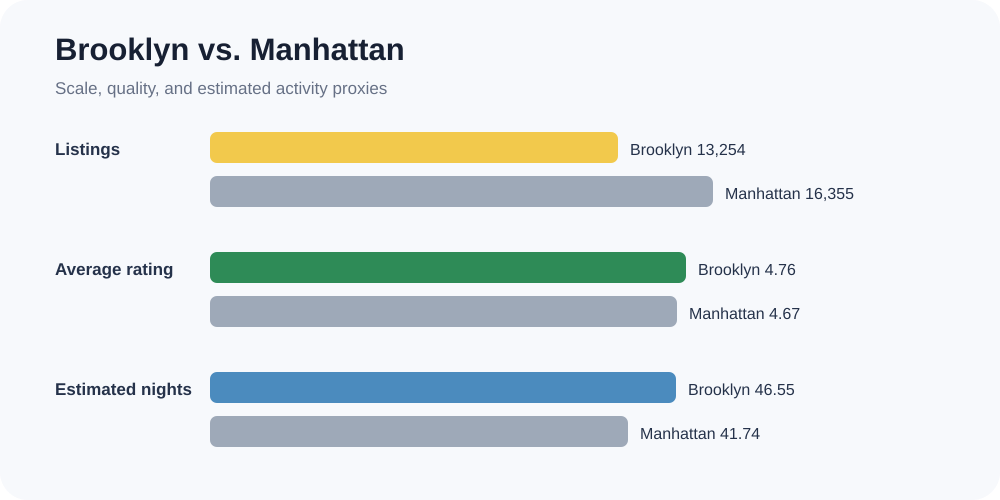
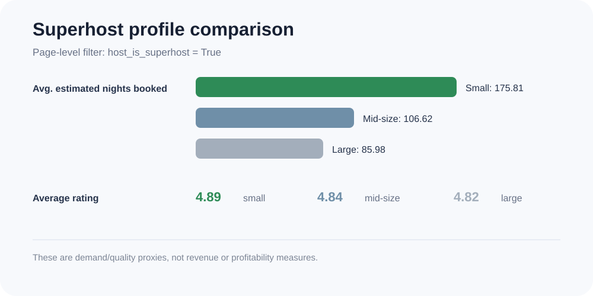

# NYC Airbnb Market Analysis | Power BI

<p align="center">
  <strong>A two-page Power BI market analysis translating 36,445 NYC Airbnb listings into an investment recommendation—with explicit limits on what the data can support.</strong>
</p>

<p align="center">
  
  
  
</p>

<p align="center">
  
</p>

## Business Question

Where and how should a boutique real-estate investment firm enter the NYC short-term-rental market if it plans to acquire a small portfolio of properties?

The analysis focuses on four decisions:

1. which borough to prioritize
2. which room type offers the strongest opportunity
3. what host profile to emulate
4. whether seasonal activity should affect timing

Because the dataset does **not** contain revenue, profit, property cost, or true occupancy, the report uses listing volume, ratings, reviews, last-review activity, and estimated nights booked as **market and demand proxies** rather than profitability measures.

## Dashboard Design

The Power BI report contains two analytical pages:

### 1. Market Overview
- KPI cards for total listings, average rating, and percent superhosts
- listings by borough
- listings by room type
- geographic map
- quarterly activity view
- room-type and borough slicers

### 2. Superhost Deep Dive
- page-level filter for superhost listings
- superhost KPIs
- superhost listings by borough
- Top-N operator table
- host-profile performance comparison

The report uses custom **DAX measures**, KPI cards, slicers, geographic and time-series visuals, Top-N filtering, conditional formatting, and page-level filters.

## Key Findings

### Brooklyn offered the strongest balance for market entry

| Metric | Brooklyn | Manhattan |
|---|---:|---:|
| Listings | **13,254** | 16,355 |
| Average rating | **4.76** | 4.67 |
| Avg. estimated nights booked | **46.55** | 41.74 |

Manhattan is the largest market, but Brooklyn combines substantial scale with stronger quality and demand proxies.

### Small superhost operators showed the strongest proxy performance

<p align="center">
  
</p>

Within the superhost-focused page, small hosts (1–2 listings) showed the highest average rating, reviews per month, and estimated nights booked among the host-profile groups.

## Recommendation

The business memo recommends:

- prioritizing **Brooklyn**
- focusing on **entire home / apartment** listings
- using a **small-host operating model** as the service benchmark
- conducting profitability and neighborhood-level analysis before any acquisition decision

This recommendation is intentionally framed as a **market-entry hypothesis**, not a claim of expected investment return.

## Evidence Limits

The source data does not directly provide:

- revenue or profit
- acquisition or financing costs
- operating expenses
- true occupancy
- complete regulatory risk
- neighborhood-level investment economics

Those gaps would need to be resolved before making an actual capital-allocation decision.

## Repository Structure

```text
nyc-airbnb-power-bi/
├── README.md
├── figures/
│   ├── borough_comparison.svg
│   └── host_profile_comparison.svg
├── report/
│   └── business_memo.md
└── data/
    └── README.md
```

## Tools & Methods

**Power BI · DAX · KPI Design · Slicers · Geographic Visualization · Time-Series Visualization · Top-N Analysis · Business Memo Writing**

## About the Data

The project uses a NYC Airbnb listings dataset with **36,445 records**. See [`data/README.md`](data/README.md) for the data-policy and interpretation notes.

---

<sub>Business intelligence project, 2026.</sub>
